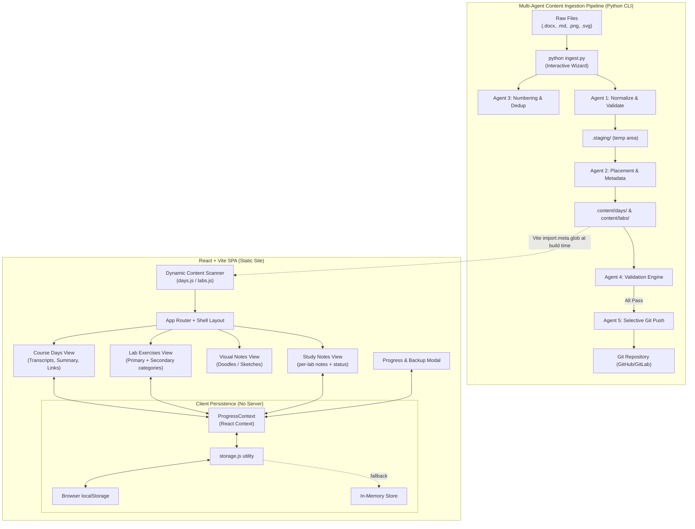
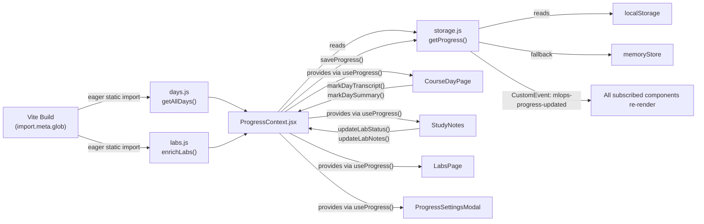
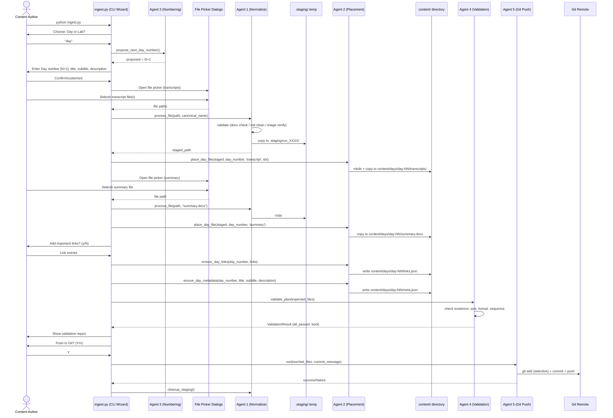

# 📐 Course Learning Portal — Generalized Blueprint

> **Purpose**: A technology-agnostic, subject-agnostic blueprint for building a fully functional, zero-backend course/study portal with a multi-agent document ingestion pipeline. Any LLM can use this document to reproduce the system end-to-end for any domain — programming, science, medicine, law, design, or any structured learning curriculum.

---

## Table of Contents

1. [System Overview](#1-system-overview)
2. [Technology Stack](#2-technology-stack)
3. [Project Directory Structure](#3-project-directory-structure)
4. [Frontend Architecture](#4-frontend-architecture)
5. [UI/UX & Design System](#5-uiux--design-system)
6. [Data Model & Content Schema](#6-data-model--content-schema)
7. [Frontend Data Flow & State Management](#7-frontend-data-flow--state-management)
8. [Pages & Routes](#8-pages--routes)
9. [Component Catalog](#9-component-catalog)
10. [Backend: Multi-Agent Ingestion Pipeline](#10-backend-multi-agent-ingestion-pipeline)
11. [Agent Specifications](#11-agent-specifications)
12. [Functional Requirements](#12-functional-requirements)
13. [Non-Functional Requirements](#13-non-functional-requirements)
14. [Document Upload & Processing Flow](#14-document-upload--processing-flow)
15. [Frontend ↔ Backend Data Mapping](#15-frontend--backend-data-mapping)
16. [How the Final Website Functions End-to-End](#16-how-the-final-website-functions-end-to-end)
17. [Configuration & Customization Points](#17-configuration--customization-points)
18. [Deployment Guide](#18-deployment-guide)

---

## 1. System Overview



### Core Concept

The portal is a **fully static single-page application** (SPA). There is no live backend server, no database, and no authentication system. All student progress is stored client-side in `localStorage`. All course content (transcripts, summaries, lab notes, doodle images) is bundled at **build time** via Vite's static asset pipeline.

The "backend" is purely a **local developer tool** — a Python CLI orchestrator that runs on the content author's machine to ingest, validate, and commit raw documents into the correct folder structure, which is then deployed via standard Git push.

---

## 2. Technology Stack

### Frontend
| Concern | Technology | Version |
|---|---|---|
| Build Tool | Vite | ^8.x |
| UI Framework | React | ^19.x |
| Routing | react-router-dom | ^7.x |
| Styling | Tailwind CSS | ^4.x (via @tailwindcss/vite) |
| Design System | Material Design 3 tokens (custom CSS) | — |
| Icons | Google Material Symbols Outlined | CDN |
| Fonts | Google Fonts: Inter (sans), JetBrains Mono (code) | CDN |
| DOCX Rendering | docx-preview | ^0.4.x |
| HTML Sanitization | DOMPurify | ^3.x |
| Markdown Rendering | Custom regex renderer (built-in, no library) | — |

### Backend (Ingestion CLI)
| Concern | Technology |
|---|---|
| Runtime | Python 3.10+ |
| DOCX validation | python-docx |
| Image validation | Pillow |
| File dialogs | tkinter (stdlib, native OS dialogs with terminal fallback) |
| Git operations | subprocess (git CLI) |
| Logging | Custom dual console+file logger |
| Testing | Python unittest |

### Deployment
| Concern | Approach |
|---|---|
| Hosting | Any static host: Netlify, GitHub Pages, Vercel, Cloudflare Pages |
| CD Pipeline | Git push → host auto-deploys from `dist/` |
| Content Publishing | `python ingest.py` → `git push` → host redeploys |

---

## 3. Project Directory Structure

```
<project-root>/
│
├── content/                          # ALL course content lives here (folder-driven)
│   ├── days/                         # One subfolder per course session/day
│   │   ├── day-01/
│   │   │   ├── meta.json             # Day metadata (title, subtitle, description, day number)
│   │   │   ├── summary.docx          # Day summary document (native Word format, preferred)
│   │   │   ├── summary.md            # Fallback: Markdown summary
│   │   │   ├── summary.html          # Fallback: HTML summary
│   │   │   ├── links.json            # Array of important resource links
│   │   │   └── transcripts/          # Session transcripts subfolder
│   │   │       ├── transcript-1.docx # First session transcript (preferred format)
│   │   │       ├── transcript-2.docx # Second session transcript
│   │   │       └── ...               # transcript-N.docx (or .md / .html fallbacks)
│   │   ├── day-02/
│   │   │   └── ...                   # Same structure
│   │   └── day-NN/
│   │       └── ...
│   │
│   └── labs/                         # Lab exercise content
│       ├── <category-a>/             # Lab category slug (e.g., "hands-on", "assessment")
│       │   ├── <lab-id>/             # Individual lab folder (slug like "01-setup-environment")
│       │   │   ├── meta.json         # Lab metadata (id, title, number, category, sourceUrl, status)
│       │   │   ├── notes.docx        # Lab notes/walkthrough (or notes.md fallback)
│       │   │   └── doodle.png        # Visual sketch for the lab (or .jpg, .svg, .webp)
│       │   └── ...
│       └── <category-b>/
│           └── ...
│
├── orchestrator/                     # Python multi-agent ingestion engine
│   ├── __init__.py
│   ├── config.py                     # Paths, file extensions, platform/category config
│   ├── cli.py                        # Interactive CLI wizard (entry point logic)
│   ├── dialogs.py                    # Native OS file dialogs with terminal fallback
│   ├── logger.py                     # Dual console + rotating file logger
│   ├── agent1_convert.py             # Agent 1: Normalize & Validate files
│   ├── agent2_placement.py           # Agent 2: Place files into content/ + write metadata
│   ├── agent3_numbering.py           # Agent 3: Sequential numbering & duplicate detection
│   ├── agent4_validation.py          # Agent 4: Post-placement integrity validator
│   └── agent5_git.py                 # Agent 5: Selective git add + commit + push
│
├── src/                              # Frontend source (React + Vite)
│   ├── main.jsx                      # App entry point (ReactDOM.createRoot)
│   ├── App.jsx                       # Root router + ProgressProvider wrapper
│   ├── config.js                     # COURSE_CONFIG: title, subtitle, logoUrl, courseUrl
│   ├── index.css                     # Tailwind v4 @theme tokens + base resets
│   │
│   ├── components/
│   │   ├── Layout.jsx                # App shell: header, sidebar, bottom nav, outlet
│   │   ├── MarkdownView.jsx          # Custom regex Markdown renderer (React component)
│   │   ├── HtmlView.jsx              # DOMPurify-sanitized HTML renderer
│   │   ├── DocxView.jsx              # docx-preview DOCX renderer (fetches + renders)
│   │   ├── LabCard.jsx               # Lab list item card (status badge, quick navigation)
│   │   ├── DoodleCard.jsx            # Visual sketch preview card for lab doodles
│   │   ├── EmptyState.jsx            # Friendly placeholder for empty content sections
│   │   ├── StatusBadge.jsx           # Color-coded badge: not-started / in-progress / done
│   │   ├── LabProgressPanel.jsx      # Progress summary panel (completion stats)
│   │   ├── PlatformSwitcher.jsx      # Tab/button switcher between lab categories
│   │   └── ProgressSettingsModal.jsx # Modal: backup export, import JSON, reset progress
│   │
│   ├── pages/
│   │   ├── CourseDayPage.jsx         # Day detail: tabbed Transcripts / Summary / Links
│   │   ├── LabsPage.jsx              # Primary labs list (category A)
│   │   ├── LabsSecondaryPage.jsx     # Secondary labs list (category B)
│   │   ├── LabDoodles.jsx            # Visual notes gallery (all doodle images)
│   │   └── StudyNotes.jsx            # Individual lab detail: notes editor + links + status
│   │
│   ├── context/
│   │   └── ProgressContext.jsx       # React Context: global progress state + actions
│   │
│   ├── data/
│   │   ├── days.js                   # Dynamic scanner: import.meta.glob → days array
│   │   └── labs.js                   # Static seed + dynamic enrichment → labs array
│   │
│   ├── hooks/
│   │   └── useLabState.js            # Hook: labs list + lab CRUD actions from context
│   │
│   └── utils/
│       └── storage.js                # localStorage / in-memory persistence layer
│
├── public/
│   ├── favicon.svg                   # Site favicon
│   ├── icons.svg                     # SVG sprite (optional)
│   └── _redirects                    # SPA redirect rule for Netlify (/* → /index.html 200)
│
├── tests/
│   └── test_ingest.py                # Python unittest suite for all 5 agents
│
├── .ingest_logs/                     # Auto-created: timestamped ingestion log files
├── .staging/                         # Auto-created: temp staging area (gitignored)
├── index.html                        # Vite HTML entrypoint (loads CDN fonts + icons)
├── vite.config.js                    # Vite config: React plugin, Tailwind plugin, assetsInclude docx
├── package.json                      # Node dependencies
├── ingest.py                         # CLI entry: `python ingest.py` (calls cli.py)
└── .gitignore                        # Excludes node_modules, dist, .staging, __pycache__
```

---

## 4. Frontend Architecture

### Application Shell Pattern

```
App.jsx
 └── ProgressProvider (React Context)
      └── BrowserRouter
           └── Routes
                └── <Route element={<Layout />}>   ← Persistent shell
                     ├── index route   → LabsPage (primary labs)
                     ├── /secondary    → LabsSecondaryPage
                     ├── /doodles      → LabDoodles
                     ├── /lab/:id      → StudyNotes
                     └── /days/:slug   → CourseDayPage
```

### Layout Component Structure

```
Layout.jsx
 ├── <header> (fixed top, z-40)
 │    ├── Logo + Course title + current page label
 │    ├── Search bar (desktop: inline, mobile: second row)
 │    └── Settings icon button (opens ProgressSettingsModal)
 │
 ├── <aside> (fixed left sidebar, desktop only, z-30)
 │    ├── Section: "Course Days"
 │    │    └── NavLink list (dynamically generated from getAllDays())
 │    ├── Section: "Lab Exercises"
 │    │    ├── NavLink → /           (Primary Labs)
 │    │    └── NavLink → /secondary  (Secondary Labs)
 │    ├── Section: "Visual Notes"
 │    │    └── NavLink → /doodles
 │    └── Footer: "Progress & Backup" button
 │
 ├── <main> (scrollable content area, padded for header + sidebar)
 │    └── <Outlet /> ← page content renders here
 │
 ├── <nav> (fixed bottom bar, mobile only, z-30)
 │    └── 3–4 NavLink icon+label items
 │
 └── <ProgressSettingsModal> (portal modal, conditionally rendered)
```

### Content Loading Strategy

All content is loaded **at build time** via Vite's `import.meta.glob`. No runtime API calls are made. The browser receives fully bundled, pre-resolved content.

```javascript
// Pattern used in days.js and labs.js:
const metaModules        = import.meta.glob('/content/days/*/meta.json',           { eager: true });
const linksModules       = import.meta.glob('/content/days/*/links.json',          { eager: true });
const summaryDocxUrls    = import.meta.glob('/content/days/*/summary.docx',        { query: '?url', import: 'default', eager: true });
const transcriptDocxUrls = import.meta.glob('/content/days/*/transcripts/*.docx',  { query: '?url', import: 'default', eager: true });
// Fallback formats:
const summaryMdModules   = import.meta.glob('/content/days/*/summary.md',          { query: '?raw', import: 'default', eager: true });
const transcriptMdModules= import.meta.glob('/content/days/*/transcripts/*.md',    { query: '?raw', import: 'default', eager: true });
```

**Priority order for content resolution:**
1. `.docx` (native Word, rendered client-side with docx-preview)
2. `.html` (raw HTML, sanitized with DOMPurify)
3. `.md` (Markdown, rendered with custom MarkdownView component)

---

## 5. UI/UX & Design System

### Design Language: Material Design 3

The entire design system is built on **Material Design 3 color tokens** implemented as CSS custom properties in `index.css` using Tailwind v4's `@theme` block.

### Color Palette (Full Token Set)

Adapt the primary/secondary/tertiary hues for your subject domain. The structure below is the template — replace hex values only.

```css
@theme {
  /* ── PRIMARY (main brand color) ───────────────────────────── */
  --color-primary:                 #004ac6;   /* Main action buttons, active states */
  --color-primary-container:       #2563eb;   /* Elevated primary surfaces */
  --color-primary-fixed:           #dbe1ff;   /* Subtle primary tints */
  --color-primary-fixed-dim:       #b4c5ff;   /* Dimmed primary tint */
  --color-on-primary:              #ffffff;   /* Text on primary buttons */
  --color-on-primary-container:    #eeefff;   /* Text on primary containers */
  --color-on-primary-fixed:        #00174b;   /* Dark text on light primary fixed */
  --color-on-primary-fixed-variant:#003ea8;
  --color-inverse-primary:         #b4c5ff;   /* Primary in dark mode context */

  /* ── SECONDARY ─────────────────────────────────────────────── */
  --color-secondary:               #0058be;
  --color-secondary-container:     #2170e4;
  --color-secondary-fixed:         #d8e2ff;
  --color-secondary-fixed-dim:     #adc6ff;
  --color-on-secondary:            #ffffff;
  --color-on-secondary-container:  #fefcff;
  --color-on-secondary-fixed:      #001a42;
  --color-on-secondary-fixed-variant: #004395;

  /* ── TERTIARY (accent, e.g. success/completion) ─────────────── */
  --color-tertiary:                #006058;
  --color-tertiary-container:      #007b71;
  --color-tertiary-fixed:          #89f5e7;
  --color-tertiary-fixed-dim:      #6bd8cb;
  --color-on-tertiary:             #ffffff;
  --color-on-tertiary-container:   #b3fff3;
  --color-on-tertiary-fixed:       #00201d;
  --color-on-tertiary-fixed-variant: #005049;

  /* ── ERROR ──────────────────────────────────────────────────── */
  --color-error:                   #ba1a1a;
  --color-error-container:         #ffdad6;
  --color-on-error:                #ffffff;
  --color-on-error-container:      #93000a;

  /* ── SURFACE HIERARCHY (light → elevated) ───────────────────── */
  --color-surface:                 #faf8ff;   /* Base page background */
  --color-surface-dim:             #d2d9f4;
  --color-surface-bright:          #faf8ff;
  --color-surface-container-lowest:#ffffff;   /* Cards (lowest elevation) */
  --color-surface-container-low:   #f2f3ff;
  --color-surface-container:       #eaedff;   /* Default containers */
  --color-surface-container-high:  #e2e7ff;
  --color-surface-container-highest:#dae2fd;
  --color-surface-variant:         #dae2fd;
  --color-surface-tint:            #0053db;
  --color-on-surface:              #131b2e;   /* Primary text */
  --color-on-surface-variant:      #434655;   /* Secondary/muted text */
  --color-on-background:           #131b2e;
  --color-background:              #faf8ff;
  --color-inverse-surface:         #283044;
  --color-inverse-on-surface:      #eef0ff;
  --color-outline:                 #737686;   /* Borders, icons */
  --color-outline-variant:         #c3c6d7;   /* Subtle borders */

  /* ── TYPOGRAPHY ─────────────────────────────────────────────── */
  --font-sans:  'Inter', system-ui, -apple-system, sans-serif;
  --font-mono:  'JetBrains Mono', ui-monospace, monospace;

  /* ── LAYOUT CONSTANTS ───────────────────────────────────────── */
  --spacing-header-height:   64px;
  --spacing-sidebar-width:   280px;
}
```

### Typography Scale

| Element | Tailwind class | Size | Weight |
|---|---|---|---|
| Page heading | `text-xl font-bold` | 20px | 700 |
| Section heading | `text-base font-semibold` | 16px | 600 |
| Body text | `text-sm` | 14px | 400 |
| Small / caption | `text-[13px]` | 13px | 400 |
| Micro / label | `text-[11px] tracking-wider uppercase font-semibold` | 11px | 600 |
| Code | `font-mono text-xs` | 12px | 400 |

### Spacing & Layout Rules

- **Header**: `fixed top-0`, `h-16` desktop / `h-28` mobile (double-row on mobile)
- **Sidebar**: `fixed left-0`, `w-72` (280px), desktop only (`md:block hidden`)
- **Main content**: `pt-28 md:pt-20 pb-20 md:pb-12 px-4 md:px-8 md:pl-72 lg:pl-80`
- **Bottom nav**: `fixed bottom-0`, mobile only (`md:hidden`), `h-16`
- **Card radius**: `rounded-xl` (12px) or `rounded-2xl` (16px) for major containers
- **Card shadow**: `shadow-sm` standard, `shadow-md` on hover
- **Card border**: `border border-outline-variant/10` (subtle)

### Interaction Patterns

| Interaction | CSS pattern |
|---|---|
| Hover on card | `hover:border-primary/40 hover:shadow-md transition-all` |
| Active nav link | `bg-primary-fixed/50 text-primary font-semibold` |
| Inactive nav link | `text-on-surface-variant hover:bg-surface-container hover:text-on-surface` |
| Primary button | `bg-primary text-on-primary hover:bg-secondary` |
| Secondary button | `bg-surface-container text-on-surface hover:bg-surface-container-high` |
| Transitions | `transition-colors` or `transition-all` with implicit 150ms |

### Responsive Breakpoints (Tailwind defaults)

| Breakpoint | Min Width | Behavior |
|---|---|---|
| (default) | 0px | Mobile layout: stacked header, bottom nav, no sidebar |
| `md:` | 768px | Desktop layout: single-row header, left sidebar, no bottom nav |
| `lg:` | 1024px | Wider sidebar padding (`lg:pl-80`) |

---

## 6. Data Model & Content Schema

### Day Object (produced by `days.js`)

```typescript
interface CourseDay {
  slug:          string;      // e.g., "day-01" (folder name)
  id:            string;      // same as slug
  dayNumber:     number;      // e.g., 1
  title:         string;      // e.g., "Day 1" or from meta.json
  subtitle:      string;      // topic subtitle
  description:   string;      // longer description paragraph
  meta:          object;      // raw meta.json contents

  summary:       string;      // content string OR docx asset URL
  summaryFormat: 'docx' | 'html' | 'md';
  summaryDocxUrl:string | null;

  links:         ResourceLink[];
  transcripts:   Transcript[];
}

interface Transcript {
  id:       string;    // "transcript-1", "transcript-2", etc.
  filename: string;    // original filename
  order:    number;    // sequential order (1-based)
  title:    string;    // "Transcript 1", etc.
  content:  string;    // content string OR docx asset URL
  fileUrl:  string | null;
  format:   'docx' | 'html' | 'md';
}

interface ResourceLink {
  label:       string;
  url:         string;
  description: string;  // optional
}
```

### meta.json (Day) — file format

```json
{
  "day":         1,
  "title":       "Day 1",
  "subtitle":    "Topic or theme of this session",
  "description": "Brief paragraph describing what this session covers."
}
```

### links.json — file format

```json
[
  {
    "label":       "Official Documentation",
    "url":         "https://example.com/docs/topic",
    "description": "The official reference guide for this topic."
  }
]
```

### Lab Object (produced by `labs.js`)

```typescript
interface Lab {
  platform:           string;       // lab category slug, e.g. "hands-on", "assessment"
  id:                 string;       // unique lab slug, e.g. "01-setup-environment"
  number:             number;       // sequential number within category
  title:              string;       // display title
  sourceUrl:          string;       // external guide URL (optional)
  summary:            string;       // static seed summary (can be empty)
  status:             LabStatus;    // "not-started" | "in-progress" | "done"
  doodleImage:        string | null;// resolved doodle image asset URL
  ingestedNotes:      string | null;// resolved notes content (HTML or MD string)
  ingestedNotesFormat:'html' | 'md';
  notesDocxUrl:       string | null;// docx asset URL if notes are .docx
  studentNotes:       string;       // persisted from localStorage (merged at runtime)
}
```

### meta.json (Lab) — file format

```json
{
  "platform":  "hands-on",
  "id":        "01-setup-environment",
  "number":    1,
  "title":     "Set Up Your Development Environment",
  "sourceUrl": "https://external-guide.example.com/lab-01",
  "status":    "not-started"
}
```

### Progress Store (localStorage) — schema

```json
{
  "version":     1,
  "lastUpdated": "2026-01-01T00:00:00.000Z",
  "labs": {
    "<lab-id>": {
      "status":    "not-started | in-progress | done",
      "notes":     "Student's freeform text notes for this lab",
      "updatedAt": "2026-01-01T00:00:00.000Z"
    }
  },
  "days": {
    "<day-slug>": {
      "transcriptsRead": ["transcript-1", "transcript-2"],
      "summaryRead":     true
    }
  },
  "customData": {}
}
```

**localStorage key**: `course-portal:progress:v1` (customize per project)

---

## 7. Frontend Data Flow & State Management



### Context API Surface (`useProgress()`)

```javascript
{
  // State
  progress: ProgressStore,       // raw store object
  labs:     Lab[],               // merged labs array (seed + persisted status)

  // Lab actions
  updateLabStatus(id, status),   // "not-started" | "in-progress" | "done"
  updateLabNotes(id, notes),     // freeform text
  getLabNotes(id),               // → string
  getLabById(id),                // → Lab | null
  getLabsByPlatform(platform),   // → Lab[]

  // Day actions
  getDayProgress(daySlug),       // → { transcriptsRead: [], summaryRead: false }
  markDayTranscript(daySlug, transcriptId),  // toggle read
  markDaySummary(daySlug),       // toggle read

  // Persistence management
  resetAllProgress(),
  exportProgress(),              // triggers JSON file download
  importProgress(jsonString),    // → { success, count | error }
}
```

### Cross-Tab Synchronization

When any tab writes to localStorage, the storage utility fires both:
1. `window.dispatchEvent(new CustomEvent('course-progress-updated', { detail: updatedStore }))` — same-tab sync
2. Native `'storage'` event — cross-tab sync (other browser tabs automatically update)

---

## 8. Pages & Routes

### Route Map

| Route | Component | Description |
|---|---|---|
| `/` | `LabsPage` | Primary labs list (category A) with status badges |
| `/secondary` | `LabsSecondaryPage` | Secondary labs list (category B) |
| `/doodles` | `LabDoodles` | Gallery of all uploaded doodle/sketch images |
| `/lab/:id` | `StudyNotes` | Individual lab: notes viewer/editor, status, links |
| `/days/:slug` | `CourseDayPage` | Course day: transcripts, summary, important links |

### CourseDayPage — Detailed Behavior

**Tabs rendered:**
1. **Transcripts** — expandable accordion cards, one per transcript file. Each has a "Mark as Read" toggle button. Count shown in tab label.
2. **Summary** — full content rendered via ContentRenderer. "Mark as Read" toggle button.
3. **Important Links** — card list of `links.json` entries. Each card shows label, description, URL. Opens in new tab.

**Navigation controls:**
- Back button (browser history)
- Breadcrumb: `COURSE SECTION • COURSE DAYS • DAY TITLE`
- Prev/Next day navigation buttons at the bottom

### StudyNotes (Lab Detail) — Detailed Behavior

**Tabs rendered:**
1. **Notes & Summary** — displays `ingestedNotes` or `studentNotes`. Edit mode (textarea) activates via "Edit" or "Write Study Notes" button. Notes are saved to localStorage.
2. **Important Links** — displays `lab.sourceUrl` as "Official Lab Guide" card + placeholder for future links.

**Controls:**
- Status cycle button: `not-started → in-progress → done → not-started`
- Next lab navigation button

### LabsPage / LabsSecondaryPage — Detailed Behavior

- Renders a `LabProgressPanel` at the top (completion stats)
- Lists all labs for the category as `LabCard` components
- Each `LabCard` shows: number badge, title, `StatusBadge`, link to `/lab/:id`

### LabDoodles — Detailed Behavior

- Grid of `DoodleCard` components
- Each card shows: doodle image (full display), lab number + title, status badge, link to `/lab/:id`
- Empty state shown if no doodles uploaded

---

## 9. Component Catalog

### `Layout.jsx`
**Responsibility**: Persistent shell wrapping all pages.
**Key props**: none (reads from router and context internally)
**State**: `drawerOpen` (mobile drawer), `settingsOpen` (settings modal)

### `MarkdownView.jsx`
**Responsibility**: Render Markdown strings as React elements without a library.
**Algorithm**: Line-by-line parser → `h1/h2/h3`, `ul/ol`, `blockquote`, `pre code`, `p`. Inline formatter handles `**bold**`, `` `code` ``, `[link](url)`.
**Input prop**: `content: string`

### `HtmlView.jsx`
**Responsibility**: Sanitize and render raw HTML strings safely.
**Implementation**: `DOMPurify.sanitize(content)` → `dangerouslySetInnerHTML`
**Input prop**: `content: string`

### `DocxView.jsx`
**Responsibility**: Fetch and render `.docx` files in the browser.
**Implementation**: `fetch(fileUrl)` → `Blob` → `renderAsync(blob, containerRef.current, undefined, options)`
**States**: loading spinner, error message, rendered document
**Input props**: `fileUrl: string`, `filename: string`

### `LabCard.jsx`
**Responsibility**: Clickable lab list item with status badge.
**Input props**: lab object, optionally onClick handler

### `DoodleCard.jsx`
**Responsibility**: Visual sketch preview card.
**Input props**: lab object (uses `lab.doodleImage`)

### `StatusBadge.jsx`
**Responsibility**: Color-coded status chip.
**Values**:
- `not-started` → gray/outline color
- `in-progress` → yellow/amber color
- `done` → green/tertiary color

### `LabProgressPanel.jsx`
**Responsibility**: Shows completion stats for the current lab category.
**Displays**: count of done / in-progress / not-started, visual progress bar

### `EmptyState.jsx`
**Responsibility**: Friendly placeholder for empty sections.
**Input props**: `icon: string` (Material Symbol name), `title: string`, `message: string`

### `ProgressSettingsModal.jsx`
**Responsibility**: Full-screen modal for progress management.
**Features**: Export progress as JSON, Import from JSON file, Reset all progress, storage usage display.

### `PlatformSwitcher.jsx`
**Responsibility**: Tab-style switcher between lab categories.
**Input props**: `platforms: {slug, label}[]`, `active: string`, `onChange: fn`

---

## 10. Backend: Multi-Agent Ingestion Pipeline

### Pipeline Overview



### Entry Point

```python
# ingest.py (project root)
from orchestrator.cli import run_orchestrator
if __name__ == '__main__':
    run_orchestrator()
```

---

## 11. Agent Specifications

### Agent 1 — Normalize & Validate (`agent1_convert.py`)

**Responsibility**: Accept a raw source file and produce a clean, validated copy in the staging directory. Never mutates the original.

**Input**: `source_path: Path`, `canonical_name: str`
**Output**: `staged_path: Path`

**Processing rules by file type:**

| Extension | Action |
|---|---|
| `.docx` | Validate with `python-docx` (open + count paragraphs). Copy as-is. |
| `.doc` | **Reject** — raise `ConversionError`. User must save as .docx first. |
| `.md`, `.txt` | Read UTF-8, normalize newlines (`\r\n` → `\n`), collapse 3+ blank lines to 2, strip trailing whitespace. Write as `.md`. |
| `.png`, `.jpg`, `.jpeg`, `.webp` | Copy as-is. Validate with `Pillow.Image.open().verify()`. |
| `.svg` | Copy as-is. Validate that `<svg` appears in content. |
| Other | Raise `ConversionError`. |

**Staging directory**: `.staging/run_{run_id}/` (8-char hex run ID, auto-cleanup in `finally`)

---

### Agent 2 — Placement & Metadata (`agent2_placement.py`)

**Responsibility**: Move staged files to canonical locations, create/update metadata JSON files.

**Day file placement:**
```
slot_type="transcript", idx=N  →  content/days/day-NN/transcripts/transcript-N.<ext>
slot_type="summary"            →  content/days/day-NN/summary.<ext>
```

**Lab file placement:**
```
slot_type="notes"   →  content/labs/<category>/<lab-id>/notes.<ext>
slot_type="doodle"  →  content/labs/<category>/<lab-id>/doodle.<ext>
```

**Metadata generation:**
- `meta.json` for days: `{ day, title, subtitle, description }`
- `links.json` for days: array of `{ label, url, description }` (merges by URL, no duplicates)
- `meta.json` for labs: `{ platform, id, number, title, sourceUrl, status }`

**Overwrite protection**: If target file already exists, prompts user interactively before overwriting.

**Images subfolder handling**: If `.html` notes contain an `images/` subfolder in staging, it is copied alongside the notes file.

---

### Agent 3 — Numbering & Dedup (`agent3_numbering.py`)

**Responsibility**: Scan existing content to propose the next safe sequential number and prevent accidental overwrites.

**Day scanning**: Reads `content/days/` for folders matching `day-NN` pattern and parses `meta.json.day` values. Proposes `max(existing) + 1`.

**Lab scanning**: Reads `content/labs/<category>/` for `NN-*` folder patterns and cross-references `src/data/labs.js` with regex extraction.

**Conflict confirmation**: If the user enters a number that already exists, explicitly asks: *"Day N already exists. Are you sure? (y/N)"*

---

### Agent 4 — Validation Engine (`agent4_validation.py`)

**Responsibility**: After placement, verify that all expected files are present, non-empty, well-formed, and correctly numbered.

**Validation checks performed:**

| Check | Condition for PASS |
|---|---|
| File existence | `Path.exists()` → True |
| File size | `stat().st_size > 0` (not empty) |
| JSON validity | Parsed without error; required keys present |
| Markdown validity | At least 1 non-empty line |
| DOCX validity | `python-docx` can open it |
| Transcript sequence | Files named `transcript-1`, `transcript-2`, ..., `transcript-N` with no gaps |
| links.json structure | Each entry has `label` and `url` keys |

**Output**: `ValidationResult` object with `all_passed: bool`, `failed_count: int`, `items: CheckItem[]`. Prints a formatted report to stdout.

---

### Agent 5 — Selective Git Push (`agent5_git.py`)

**Responsibility**: Stage only the files touched during this ingestion run, commit with an auto-generated message, and push to the current branch.

**Preconditions checked:**
- Workspace is a valid git repository (`git rev-parse --is-inside-work-tree`)
- Touched files actually exist on disk

**Operations:**
1. `git add -- <file1> <file2> ...` (selective staging — no `git add .`)
2. `git diff --cached --name-only` (verify staged changes exist)
3. `git commit -m "<auto-message>"`
4. `git push origin <current-branch>`

**Auto-generated commit messages:**
- Day: `"Add Day NN: M transcripts, summary"`
- Lab: `"Add Lab NN: <category> - <title>"`

**Push failure handling**: If push fails (network or remote rejection), the commit is preserved locally. User is shown manual push instructions. No data is lost.

---

## 12. Functional Requirements

### FR-01: Course Day Management
- The system MUST support organizing content by sequential numbered days
- Each day MUST support 1–N transcript documents
- Each day MUST support exactly one summary document
- Each day MUST support 0–N resource links in `links.json`
- Each day MUST have a `meta.json` with at minimum `day` (number) and `title`

### FR-02: Lab Exercise Management
- The system MUST support organizing labs by category (platform/type)
- Each lab MUST have a unique slug ID within its category
- Each lab MUST support a doodle/sketch image
- Each lab MUST support a notes document
- Each lab MUST have a status: `not-started`, `in-progress`, `done`

### FR-03: Student Progress Tracking
- Student progress MUST persist across browser sessions (localStorage)
- Progress MUST include: lab status, lab notes, transcript read flags, summary read flag
- Progress MUST be exportable as a JSON file
- Progress MUST be importable from a previously exported JSON file
- Progress MUST be resettable
- Progress MUST sync across tabs in the same browser

### FR-04: Content Rendering
- The system MUST render `.docx` files natively in the browser (preserving Word formatting)
- The system MUST render `.md` files as formatted HTML
- The system MUST render `.html` files with XSS sanitization
- Content renderers MUST be interchangeable (same props API)

### FR-05: Content Ingestion
- The ingestion pipeline MUST validate all files before placing them
- The ingestion pipeline MUST prevent silent overwrites
- The ingestion pipeline MUST support sequential numbering with dedup detection
- The ingestion pipeline MUST produce a human-readable validation report
- The ingestion pipeline MUST support selective git commits (not `git add .`)

### FR-06: Search (Structural Requirement)
- A search input MUST be present in the header on all pages
- The search input MUST be functional (filtering labs/days by title)

### FR-07: Navigation
- Prev/Next navigation MUST be available on CourseDayPage
- Next lab navigation MUST be available on StudyNotes
- Mobile bottom navigation MUST provide quick access to main sections

---

## 13. Non-Functional Requirements

### NFR-01: Performance
- Build output MUST be a fully optimized static bundle (Vite `npm run build`)
- All content is loaded at build time — zero runtime API calls
- Initial page load target: < 2 seconds on 4G mobile
- JavaScript bundle MUST be code-split by route

### NFR-02: Accessibility
- All interactive elements MUST have minimum touch target size of 44×44px
- Color contrast MUST meet WCAG AA ratios
- All icon buttons MUST have `aria-label` attributes
- Navigation MUST be keyboard-accessible

### NFR-03: Responsive Design
- ALL pages MUST be fully functional on 320px–1920px screen widths
- Mobile layout (< 768px): stacked header, bottom navigation, no sidebar drawer
- Desktop layout (≥ 768px): single-row header, left sidebar, no bottom nav

### NFR-04: Offline Capability
- Once loaded, the site MUST function without internet (all assets bundled)
- Student progress persists offline (localStorage)

### NFR-05: Browser Support
- Chrome, Edge, Firefox, Safari — latest 2 major versions
- Both desktop and mobile browser variants

### NFR-06: Security
- All user-rendered HTML MUST be sanitized with DOMPurify before injection
- No external API calls from the frontend at runtime
- No sensitive data stored (no authentication, no PII beyond optional notes)

### NFR-07: Maintainability
- Adding a new course day requires only: running `python ingest.py` and `git push`
- No code changes needed to add content
- Configuration is centralized in `src/config.js` (single source of truth for branding)

### NFR-08: Testability
- All 5 agent classes MUST have isolated unit tests
- Tests MUST run in a sandboxed temp directory (no mutation of real `content/`)
- Test suite: `python -m unittest tests/test_ingest.py`

### NFR-09: Deployment
- The site MUST deploy to any static hosting provider from the `dist/` folder
- SPA routing MUST be handled by a `_redirects` file (Netlify) or equivalent
- Build command: `npm run build` | Output: `dist/`

---

## 14. Document Upload & Processing Flow

### For a New Course Day

```
User runs: python ingest.py
     │
     ├─► Agent 3 scans content/days/ → proposes next day number
     │
     ├─► User enters: day number, title, subtitle, description
     │
     ├─► For each transcript (1..N):
     │    ├─► Native OS file dialog opens (or terminal path prompt)
     │    ├─► User selects .docx / .md / .txt file
     │    ├─► Agent 1: validate + copy to .staging/run_XXXX/transcript-N.docx
     │    └─► Agent 2: copy to content/days/day-NN/transcripts/transcript-N.docx
     │
     ├─► File dialog for summary:
     │    ├─► User selects .docx / .md / .txt
     │    ├─► Agent 1: validate + copy to .staging/run_XXXX/summary.docx
     │    └─► Agent 2: copy to content/days/day-NN/summary.docx
     │
     ├─► Optional links input:
     │    └─► Agent 2: write/merge content/days/day-NN/links.json
     │
     ├─► Agent 2: write content/days/day-NN/meta.json
     │
     ├─► Agent 4: validate all expected files → print report
     │    ├─► [PASS] transcript-1.docx — Valid Word document (42 paragraphs, 2840 bytes)
     │    ├─► [PASS] summary.docx — Valid Word document
     │    ├─► [PASS] meta.json — Valid JSON (required keys present)
     │    └─► [PASS] links.json — Valid JSON (1 entries)
     │
     ├─► Agent 5: git add (selective) + commit + push
     │
     └─► Agent 1: cleanup .staging/run_XXXX/
```

### For a New Lab

```
User runs: python ingest.py → chooses "lab"
     │
     ├─► User selects category (e.g., "hands-on")
     │
     ├─► Agent 3: scan category dir → propose next lab number
     │
     ├─► User enters: lab number, title, lab ID slug, source URL
     │
     ├─► File dialog for doodle image:
     │    ├─► User selects .png / .jpg / .svg / .webp
     │    ├─► Agent 1: validate image (PIL verify) + copy to .staging/
     │    └─► Agent 2: copy to content/labs/<category>/<lab-id>/doodle.<ext>
     │
     ├─► File dialog for notes:
     │    ├─► User selects .docx / .md / .txt
     │    ├─► Agent 1: validate + copy to .staging/
     │    └─► Agent 2: copy to content/labs/<category>/<lab-id>/notes.<ext>
     │
     ├─► Agent 2: write content/labs/<category>/<lab-id>/meta.json
     │
     ├─► Agent 4: validate → print report
     │
     └─► Agent 5: git add + commit + push
```

### File Naming Convention

| Content Type | File Name | Location |
|---|---|---|
| Day transcript | `transcript-{N}.docx` | `content/days/day-{NN}/transcripts/` |
| Day summary | `summary.docx` | `content/days/day-{NN}/` |
| Day metadata | `meta.json` | `content/days/day-{NN}/` |
| Day links | `links.json` | `content/days/day-{NN}/` |
| Lab doodle | `doodle.{ext}` | `content/labs/{category}/{lab-id}/` |
| Lab notes | `notes.docx` or `notes.md` | `content/labs/{category}/{lab-id}/` |
| Lab metadata | `meta.json` | `content/labs/{category}/{lab-id}/` |

---

## 15. Frontend ↔ Backend Data Mapping

### How File Paths Map to React Data

```
content/days/day-NN/meta.json
  → parsed by days.js via import.meta.glob
  → becomes day.title, day.subtitle, day.description, day.dayNumber

content/days/day-NN/transcripts/transcript-N.docx
  → imported as asset URL by days.js
  → becomes day.transcripts[N-1].content (docx URL)
  → rendered by DocxView component via fetch()

content/days/day-NN/summary.docx
  → imported as asset URL by days.js
  → becomes day.summary (docx URL) + day.summaryFormat = 'docx'
  → rendered by ContentRenderer → DocxView

content/days/day-NN/links.json
  → parsed by days.js
  → becomes day.links[] array

content/labs/<category>/<lab-id>/meta.json
  → parsed by labs.js, merged with INITIAL_LABS seed
  → becomes lab.title, lab.number, lab.sourceUrl, etc.

content/labs/<category>/<lab-id>/doodle.<ext>
  → imported as asset URL by labs.js
  → becomes lab.doodleImage (URL)
  → rendered by  in DoodleCard

content/labs/<category>/<lab-id>/notes.docx
  → imported as asset URL by labs.js
  → becomes lab.notesDocxUrl
  → rendered by DocxView in StudyNotes

content/labs/<category>/<lab-id>/notes.md
  → imported as raw string by labs.js
  → becomes lab.ingestedNotes (string) + lab.ingestedNotesFormat = 'md'
  → rendered by MarkdownView in StudyNotes
```

### Runtime State Merge (labs.js enrichment)

```javascript
// 1. Seed data (static, in labs.js):
INITIAL_LABS = [{ platform, id, number, title, sourceUrl, status: 'not-started', ... }]

// 2. Dynamic enrichment at module load time:
enrichLabs() {
  doodleMap = {}     // lab key → doodle image URL (from import.meta.glob)
  notesMap  = {}     // lab key → notes content (HTML or MD string)
  metaModules = {}   // lab key → meta.json contents (overrides seed)

  // Merge: seed + content/labs/ meta.json + doodle URLs + notes
  return merged labs array, sorted by category then number
}

// 3. ProgressContext runtime merge:
labs = ENRICHED_LABS.map(lab => ({
  ...lab,
  status:       store.labs[lab.id]?.status || lab.status,
  studentNotes: store.labs[lab.id]?.notes || '',
}))
```

### Data Flow Timeline

| Phase | When | What happens |
|---|---|---|
| **Ingest time** | `python ingest.py` runs | Files placed in `content/`, metadata JSONs written |
| **Build time** | `npm run build` runs | Vite resolves `import.meta.glob`, bundles all content as static assets |
| **Load time** | Browser loads the page | App hydrates, `days.js` and `labs.js` modules execute synchronously |
| **Runtime** | User interacts | Context actions call `storage.js`, localStorage persists changes |

---

## 16. How the Final Website Functions End-to-End

### Student Journey: Browsing Course Days

1. Student opens the portal URL
2. Layout renders: header (logo, title, search bar), sidebar (course day list, lab links), main content area
3. Sidebar shows all course days (dynamically generated from `getAllDays()`)
4. Student clicks "Day 3" in sidebar → navigates to `/days/day-03`
5. `CourseDayPage` renders:
   - Day number badge + title + subtitle + description card
   - Three tabs: **Transcripts** (count badge), **Summary**, **Important Links**
6. Student clicks "Transcripts" tab (default):
   - Each transcript appears as a collapsed card with expand button
   - Student expands Transcript 1 → `DocxView` fetches and renders the .docx file
   - Student clicks "Mark as Read" → state saved to localStorage
7. Student switches to "Summary" tab → `DocxView` renders summary.docx
8. Student clicks "Mark as Read" for summary
9. Student switches to "Important Links" → sees link cards with label, description, URL
10. Student clicks "Next: Day 4" → navigates to `/days/day-04`

### Student Journey: Tracking Lab Progress

1. Student clicks "Lab Exercises" in sidebar → `/` (primary labs page)
2. `LabProgressPanel` shows: 2 Done, 1 In Progress, 4 Not Started (progress bar)
3. `LabCard` list shows all labs with colored `StatusBadge`
4. Student clicks Lab 3 → navigates to `/lab/03-setup-environment`
5. `StudyNotes` renders:
   - Lab number badge + title + status badge + "Official Lab Guide" external link
   - Two tabs: **Notes & Summary**, **Important Links**
6. Student views ingested notes (`.docx` via `DocxView`)
7. Student clicks "Edit" → textarea appears, student types their study notes
8. Student clicks "Save" → notes persisted to localStorage
9. Student clicks "Mark as Done" → status cycles: `in-progress → done`
10. Status badge updates immediately; `LabProgressPanel` re-renders with updated count
11. Student clicks "Next: Lab 04" → navigates

### Student Journey: Visual Notes Gallery

1. Student clicks "Visual Notes" in sidebar → `/doodles`
2. Grid of `DoodleCard` components appears
3. Each card shows the full doodle image, lab title, status badge
4. Student clicks a card → navigates to that lab's `/lab/:id` page

### Student Journey: Progress Backup

1. Student clicks the ⚙ settings icon in header → `ProgressSettingsModal` opens
2. Modal shows: storage usage, last updated timestamp
3. Student clicks "Export Progress" → browser downloads `course-portal-progress-2026-01-01.json`
4. Student can import this file on another device
5. Student can "Reset All Progress" (with confirmation)

### Content Author Journey: Adding New Content

1. Author runs `python ingest.py`
2. Wizard asks: Day or Lab?
3. Author selects "Day", enters day number (auto-proposed), title, subtitle, description
4. For each transcript: native OS file picker opens, author selects `.docx` file
5. For summary: file picker opens, author selects `.docx` file
6. Author optionally adds resource links
7. Agent 4 validation report shown — all PASS
8. Author confirms git push → content committed and pushed
9. Static host (Netlify/etc.) auto-deploys from the new commit
10. Within ~60 seconds, the new day appears in the portal for all students

---

## 17. Configuration & Customization Points

### Primary Configuration: `src/config.js`

```javascript
export const COURSE_CONFIG = {
  title:     'Class Notes',                      // Header title (customize per course)
  subtitle:  'Your Course Name and Code Here',   // Header subtitle
  code:      'COURSE-101',                       // Short course code
  courseUrl: 'https://your-course-url.example.com',
  logoUrl:   'https://your-logo-image-url',      // Logo in header
};
```

### Lab Categories: `orchestrator/config.py`

```python
PLATFORMS = {
    "1": ("category-a", "Display Name for Category A"),
    "2": ("category-b", "Display Name for Category B"),
    # Add more categories here
}

# Optional: pre-seed known lab titles for auto-suggestions
KNOWN_CATEGORY_A_LABS = {
    1: { "id": "01-first-lab", "title": "First Lab Title", "sourceUrl": "..." },
}
```

### localStorage Key: `src/utils/storage.js`

```javascript
export const STORAGE_KEY = 'course-portal:progress:v1';
// Change 'course-portal' to a unique identifier per portal instance
// to avoid progress collision if student uses multiple portals in same browser
```

### Route Labels: `src/components/Layout.jsx`

```javascript
function pageLabel(pathname) {
  if (pathname.startsWith('/days'))      return 'Course Days';
  if (pathname.startsWith('/secondary')) return 'Secondary Labs';
  if (pathname.startsWith('/doodles'))   return 'Visual Notes';
  if (pathname.startsWith('/lab/'))      return 'Study Notes';
  return 'Lab Exercises';
}
```

### Adding a Lab Category

1. Add to `PLATFORMS` in `orchestrator/config.py`
2. Create `src/pages/LabsSecondaryPage.jsx` (copy `LabsPage.jsx`, filter by new category slug)
3. Add route in `App.jsx`: `<Route path="secondary" element={<LabsSecondaryPage />} />`
4. Add NavLink in `Layout.jsx` sidebar
5. Add to mobile bottom nav if desired

### Color Theme Customization

Replace the hex values in `src/index.css` `@theme {}` block:
- Use [Material Theme Builder](https://m3.material.io/theme-builder) to generate a full palette from one seed color
- The seed color = `--color-primary`
- All other tokens are derived algorithmically from the seed

---

## 18. Deployment Guide

### Initial Setup

```bash
# 1. Clone or create new repo
git clone <your-repo-url>
cd <project>

# 2. Install Node.js dependencies
npm install

# 3. Install Python dependencies
pip install python-docx Pillow

# 4. Run dev server
npm run dev
# → http://localhost:5173/
```

### Content Authoring Workflow

```bash
# Add new content (interactive wizard)
python ingest.py

# Run tests after changes to orchestrator code
python -m unittest tests/test_ingest.py
```

### Production Deployment

```bash
# Build static site
npm run build
# → dist/ folder contains deployable site

# Preview build locally
npm run preview
```

### Netlify (Recommended)

1. Connect your Git repo to Netlify
2. Build command: `npm run build`
3. Publish directory: `dist`
4. Ensure `public/_redirects` contains: `/* /index.html 200`
5. Every `git push` triggers automatic redeploy

### GitHub Pages

1. Install `gh-pages`: `npm install --save-dev gh-pages`
2. Add to `package.json` scripts: `"deploy": "gh-pages -d dist"`
3. Set `base: '/your-repo-name/'` in `vite.config.js`
4. Run: `npm run build && npm run deploy`

### Environment Variables (if needed in future)

Vite exposes env vars prefixed with `VITE_` to the client:
```bash
# .env.local
VITE_COURSE_TITLE="My Course Portal"
```
```javascript
// Access in code:
const title = import.meta.env.VITE_COURSE_TITLE;
```

---

## Appendix: Checklist for Reproducing This System

### Phase 1: Scaffold
- [ ] Initialize Vite + React project (`npm create vite@latest`)
- [ ] Install dependencies: `tailwindcss`, `@tailwindcss/vite`, `react-router-dom`, `docx-preview`, `dompurify`
- [ ] Set up `vite.config.js` with React plugin, Tailwind plugin, `assetsInclude: ['**/*.docx']`
- [ ] Create `index.html` with CDN links for Google Fonts (Inter, JetBrains Mono) and Material Symbols Outlined
- [ ] Set up `src/index.css` with the full `@theme {}` color token block

### Phase 2: Content Structure
- [ ] Create `content/days/` and `content/labs/` directories
- [ ] Create placeholder `day-01/` with `meta.json`, empty `transcripts/`
- [ ] Create placeholder lab directories with `meta.json`

### Phase 3: Frontend Core
- [ ] `src/config.js` — COURSE_CONFIG
- [ ] `src/utils/storage.js` — full localStorage utility with event system
- [ ] `src/context/ProgressContext.jsx` — full Context with all actions
- [ ] `src/data/days.js` — full import.meta.glob scanner
- [ ] `src/data/labs.js` — INITIAL_LABS seed + enrichLabs() function
- [ ] `src/hooks/useLabState.js` — hook wrapping context

### Phase 4: Components
- [ ] `Layout.jsx` — shell with header, sidebar, bottom nav, outlet
- [ ] `MarkdownView.jsx` — custom markdown parser
- [ ] `HtmlView.jsx` — DOMPurify renderer
- [ ] `DocxView.jsx` — docx-preview renderer
- [ ] `StatusBadge.jsx` — 3-state badge
- [ ] `LabCard.jsx`, `DoodleCard.jsx`, `EmptyState.jsx`
- [ ] `LabProgressPanel.jsx`
- [ ] `ProgressSettingsModal.jsx`

### Phase 5: Pages
- [ ] `CourseDayPage.jsx` — 3-tab layout with ContentRenderer
- [ ] `LabsPage.jsx` / `LabsSecondaryPage.jsx` — lab list views
- [ ] `StudyNotes.jsx` — notes editor + status cycle
- [ ] `LabDoodles.jsx` — doodle gallery
- [ ] Wire routes in `App.jsx`

### Phase 6: Ingestion Pipeline
- [ ] `orchestrator/__init__.py`
- [ ] `orchestrator/config.py` — paths, platforms, extensions
- [ ] `orchestrator/logger.py` — dual console + file logger
- [ ] `orchestrator/dialogs.py` — tkinter file picker with terminal fallback
- [ ] `orchestrator/agent1_convert.py`
- [ ] `orchestrator/agent2_placement.py`
- [ ] `orchestrator/agent3_numbering.py`
- [ ] `orchestrator/agent4_validation.py`
- [ ] `orchestrator/agent5_git.py`
- [ ] `orchestrator/cli.py` — full wizard
- [ ] `ingest.py` — entry point

### Phase 7: Testing & Deployment
- [ ] `tests/test_ingest.py` — unit tests for all 5 agents
- [ ] `public/_redirects` — SPA redirect rule
- [ ] `.gitignore` — exclude `node_modules/`, `dist/`, `.staging/`, `__pycache__/`, `.ingest_logs/`
- [ ] Connect to Netlify / GitHub Pages
- [ ] Run `npm run build` → verify zero errors
- [ ] Run `python ingest.py` → ingest first day → verify it appears in browser
