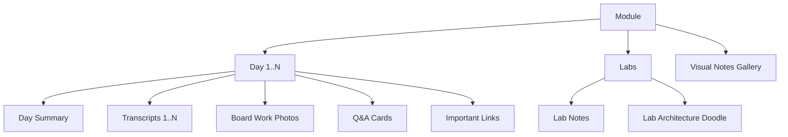

# Course Portal User Guide (HOW_TO_USE.md)

Welcome to the **Race | AI 13 | Transcripts & Summary** portal content management guide. This guide is written for instructors, teaching assistants, and course organizers who want to upload and manage class documents (`.docx`, `.md`, `.pdf`, images) quickly, reliably, and without writing code.

---

## 1. What This Site Is and How It Works

The course portal is split into **three decoupled parts**:

```
┌────────────────────────┐      ┌────────────────────────┐      ┌────────────────────────┐
│     Your Laptop        │      │    Cloudflare R2       │      │   Cloudflare Pages     │
│  (python ingest.py)    │ ───► │  (Object Store Bucket) │ ◄─── │  (Fast Web Frontend)   │
│ Ingests 1 item at time │      │ Holds JSONs & docs     │      │ Readers browse portal  │
└────────────────────────┘      └────────────────────────┘      └────────────────────────┘
```

1. **The Ingest Tool on your computer** (`python ingest.py`): A fast, interactive Python CLI that processes your documents one at a time, converts and normalizes images, updates metadata manifests, and uploads files.
2. **Cloudflare R2 Bucket**: High-speed cloud object storage that hosts all your documents, transcripts, summaries, photos, and JSON manifests.
3. **Cloudflare Pages Website**: The student-facing React web application that renders documents, searchable quizzes, code snippets, and study progress.

> [!IMPORTANT]
> **The Golden Rule**: Content updates **never** require a Git commit or a site redeploy. You upload documents directly to R2 using `python ingest.py`. Your live website reflects changes within seconds.

---

## 2. One-Time Setup Checklist

Follow these 5 steps to get your computer ready:

1. **Check Python Version**: Make sure Python 3.10 or newer is installed:
   ```bash
   python --version
   ```
2. **Install Python Dependencies**:
   ```bash
   pip install -r requirements.txt
   ```
3. **Create your `.env` File**:
   Copy `.env.example` to `.env` in the root folder:
   ```bash
   cp .env.example .env
   ```
   Fill in your Cloudflare R2 bucket details:
   ```env
   R2_ACCOUNT_ID=your_cloudflare_account_id
   R2_ACCESS_KEY_ID=your_r2_access_key_id
   R2_SECRET_ACCESS_KEY=your_r2_secret_access_key
   R2_BUCKET_NAME=your_bucket_name
   R2_PUBLIC_BASE_URL=https://your-public-cdn-url.example.com
   ```
4. **Test the Connection**:
   ```bash
   python ingest.py check-connection
   ```
   *Expected output:* `[PASS] Successfully connected and authenticated with Cloudflare R2 bucket!`
5. **Initialize Storage Bootstrap Files**:
   ```bash
   python ingest.py init
   ```
   *Expected output:* `Successfully initialized repository bootstrap files: index.json and search-index.json`

---

## 3. Preparing a Document Before Upload

- **Always use modern `.docx` (not old `.doc`)**: The portal web viewer renders Word XML (`.docx`) natively in the student's browser. Legacy binary `.doc` files are automatically rejected.
- **Upload ONE file at a time**: The CLI is designed to do atomic, validated updates. Never drag multiple files or entire directories at once.
- **Recommended File Naming**: Use clean, descriptive names:
  - Day summary: `day-01-summary.docx`
  - Transcripts: `day-01-transcript-part1.docx`, `day-01-transcript-part2.md`
  - Whiteboard photos: `day-01-board-architecture.jpg`
  - Questions: `day-01-questions.md`
- **File Size Guidance**:
  - Documents (`.docx`, `.md`, `.pdf`): Recommended under 10 MB.
  - Board photos: The ingest tool automatically resizes large photos (e.g. 4000×3000 down to max 2000px WebP) and strips all camera EXIF metadata, reducing sizes from 10 MB down to < 500 KB.
- **Privacy Notice**: The site is publicly accessible to anyone with the link. Do not upload API keys, passwords, student grade sheets, or confidential credentials.

---

## 4. The Content Model

The course content is structured in an intuitive hierarchy:

```
Course Portal
  │
  ├── Module (e.g., Machine Learning Operations, Deep Learning Systems)
  │     │
  │     ├── Days (Day 1, Day 2, Day 3...)
  │     │     ├── Summary (.docx / .md)
  │     │     ├── Transcripts (Part 1, Part 2...)
  │     │     ├── Important Links (Documentation, GitHub repos)
  │     │     ├── Class Board Work (Whiteboard photos & sketches)
  │     │     └── Questions (Interactive Q&A quiz cards)
  │     │
  │     └── Labs
  │           ├── Hands-on Lab Guides
  │           ├── Solution Notes (.docx / .md)
  │           └── Architecture Doodles & Sketches
  │
  └── Visual Notes (Aggregated gallery of all board work & doodles)
```



---

## 5. First-Time Walkthrough (Step-by-Step)

Start the ingest tool by running:
```bash
python ingest.py
```

### Step 1: Create a Course Module
1. In the menu, select: `create-module`
2. **Module Title:** `Machine Learning Operations (AI-300)`
3. **Module Slug (kebab-case):** `mlops-ai-300` (press Enter to accept default)
4. **Subtitle:** `Production Pipelines & Cloud Model Engineering`
5. **Description:** `Complete guide to building robust MLOps on cloud infrastructure.`
6. **Course Code:** `AI-300`
7. Press `Y` to confirm.

### Step 2: Create Day 1
1. In the menu, select: `create-day`
2. Choose your module: `mlops-ai-300`
3. **Day Number:** `1`
4. **Day Title:** `Day 1: Architectural Foundations`
5. **Day Subtitle:** `Compute, Data & Workspace Setup`
6. **Day Description:** `Setting up cloud compute instances and role-based access.`
7. **In a nutshell (recap):** `Today we set up compute clusters, storage accounts, and learned how managed identities replace passwords.`

### Step 3: Add Day Summary
1. Select: `add/replace summary`
2. Select module: `mlops-ai-300` -> Select Day: `Day 1`
3. A native file picker dialog opens (or type the path): Select `day-01-summary.docx`
4. Confirm upload: Press `Y`.

### Step 4: Add Transcripts
1. Select: `add transcript`
2. Select module and day.
3. Select file: `morning-lecture-transcript.docx`
4. **Transcript Title:** `Morning Session — Cloud Architecture & Compute Setup`
5. Press `Y` to upload. Repeat for afternoon session!

### Step 5: Add an Important Link
1. Select: `add link`
2. Select module and day.
3. **URL:** `https://learn.microsoft.com/azure/machine-learning/`
4. **Title:** `Official Azure Machine Learning Documentation`
5. **Category:** `documentation`

### Step 6: Add the Questions Set
1. Select: `add questions-set`
2. Select module and day.
3. Select your markdown questions file: `day-01-questions.md`
4. The tool validates the format and uploads all questions instantly.

---

## 6. The Questions File Format & AI Generator Prompt

Questions appear on each Day page as interactive cards with flashcard flips, "Explain simply" analogies, search filters, and "Mark understood" checkmarks.

### Questions Markdown Format (`questions.md`)
Run `python ingest.py questions-template` to create a starter template:
```markdown
## Q1: What is the primary difference between Managed Identity and Storage Access Keys?
**Answer:** Managed Identity eliminates storing secrets or rotating passwords by delegating authentication directly to Azure Active Directory.
**Explain simply:** Think of access keys like a physical house key you can accidentally drop or lose; Managed Identity is like facial recognition built directly into the front door.
**Tags:** Security, Identity, Azure

## Q2: Why configure training compute clusters to auto-scale down to zero nodes?
**Answer:** Setting minimum nodes to 0 ensures you incur zero billing charges when no training jobs are actively executing.
**Explain simply:** Like turning off the lights when leaving a room, auto-scale shuts down cloud servers the second they finish work.
**Tags:** Cost, Compute, Optimization

## Q3: What is the function of an Azure Machine Learning Datastore?
**Answer:** A Datastore stores connection information to cloud storage services like Azure Blob or Data Lake without hardcoding credentials in training scripts.
**Explain simply:** A Datastore is like a bookmark in your web browser that takes your code directly to the right cloud folder safely.
**Tags:** Data, Storage, Architecture
```

### AI Generator Prompt
Copy-paste this prompt into ChatGPT, Claude, or Gemini along with your raw class transcript:

```text
You are an expert technical educator. Read the attached lecture transcript and generate:
1. A concise "In a nutshell: what happened in class" recap (2-3 sentences).
2. Exactly 10 comprehensive student study questions based on the class topics.

Follow this EXACT markdown template for the questions without numbering deviations:

## Q1: [Clear, direct question about a core concept covered in class?]
**Answer:** [Accurate, technical explanation in 1-2 concise sentences.]
**Explain simply:** [An intuitive real-world analogy that makes the concept crystal clear to a beginner.]
**Tags:** [Tag1, Tag2, Tag3]

## Q2: [Next question...]
...
```

---

## 7. Everyday Workflow ("After Every Class")

Use this 4-step checklist after each training session:

1. **Save your files**: Save your summary `.docx`, transcript `.docx`, whiteboard photos (`.jpg`), and `questions.md` into a working folder on your desktop.
2. **Launch CLI**:
   ```bash
   python ingest.py
   ```
3. **Ingest in order**:
   - `create-day` (if this is a new day)
   - `add/replace summary`
   - `add transcript` (one per lecture session)
   - `add board photo` (for each whiteboard picture)
   - `add questions-set` (your 10 Q&A cards)
   - `add link` (relevant docs or notebooks)
4. **Verify live**: Refresh the website to see the new day and content appear.

---

## 8. Fixing Mistakes & CLI Maintenance Tools

The CLI provides built-in safety tools to fix any mistake:

| Task | Command | How it works |
| :--- | :--- | :--- |
| **Replace an uploaded file** | `python ingest.py` -> `add/replace summary` | The tool detects the existing file, warns you, and prompts for explicit confirmation before overwriting. |
| **Remove an item** | `python ingest.py remove` | Supports removing a single transcript, photo, question, link, summary, lab, whole day, or module. Requires typing the exact item name to prevent accidents. |
| **Undo last change** | `python ingest.py undo` | Automatically reverts the last operation: deletes newly uploaded files on R2 and restores manifests byte-for-byte from local backups in `.ingest_backups/`. |
| **Verify content integrity** | `python ingest.py verify` | Checks all JSON schemas, tests that every referenced file exists on R2, and checks for zero dangling links or broken images. |
| **Rebuild all indexes** | `python ingest.py rebuild-index` | Recalculates all totals, rebuilds search indexes, and synchronizes manifest totals. |
| **Inspect content tree** | `python ingest.py list` | Prints a rich visual tree of all modules, days, counts, and labs currently stored in the cloud. |

---

## 9. How Long Until Changes Appear?

- **JSON Manifests Cache**: Manifests (`manifest.json`, `index.json`, `day.json`) are cached for **60 seconds** on the Cloudflare edge.
- **Document & Image Files**: Files (`.docx`, `.pdf`, `.webp`) are cached immutably with content-hash filenames.
- **Instant verification**: If you don't want to wait 60 seconds, do a hard-refresh in your browser (`Ctrl + Shift + R` on Windows/Linux or `Cmd + Shift + R` on Mac).

---

## 10. Safe Practice Mode: `--dry-run` and `--target local`

Want to practice without touching your live production bucket?

### Preview Changes with `--dry-run`
Simulates the entire operation, calculates file hashes, normalizes images, and prints the exact upload plan without sending any data to R2:
```bash
python ingest.py --dry-run
```

### Test Locally with `--target local`
Stores everything into a local `./dev-content` directory on your computer:
```bash
python ingest.py --target local
```
You can view your changes locally by running the frontend dev server:
```bash
npm run dev
```

---

## 11. Student Reader's Guide

Share these tips with your students:

- **Sidebar Navigation**: Click any module to expand days. Subtitles are truncated with an ellipsis and reveal the full topic on mouse hover or keyboard focus.
- **Day Tabs**: Order is fixed for optimal learning: **Summary ➔ Transcripts ➔ Important Links ➔ Class Board Work ➔ Questions**.
- **Instant Search (`Ctrl + K` or `Cmd + K`)**: Search across all modules, lecture transcripts, labs, and question cards with fuzzy keyword search.
- **Track Progress**: Click the circular checkmark on any item to mark it understood.
- **Progress & Backup**: Click the database icon at the bottom of the sidebar to view total stats. Use **Export Progress (JSON)** to transfer study progress across devices or backup study notes.
- **Theme Toggle**: Switch between clean Light mode and eye-friendly Dark Navy mode.
- **Mobile Friendly**: Full-screen slide-in drawer on smartphones with safe-area navigation.

---

## 12. Storage & Cloudflare Free Limits

| Service | Free Tier Allowance | Usage in this Portal |
| :--- | :--- | :--- |
| **Cloudflare R2** | 10 GB storage free, 10M read requests/month, zero egress bandwidth fees | Easily holds hundreds of lecture days and thousands of documents at zero cost. |
| **Cloudflare Pages** | Unlimited bandwidth, 500 static builds per month | Only code improvements consume builds; daily document uploads use **0** builds. |

> [!TIP]
> Keep your raw originals (e.g. Word documents and full-resolution camera photos) stored in your personal Google Drive or OneDrive folder. R2 stores web-optimized, normalized copies.

---

## 13. Troubleshooting Guide

| Symptom | Probable Cause | Quick Fix |
| :--- | :--- | :--- |
| **"Content URL not configured" error screen** | `VITE_CONTENT_BASE_URL` is missing or empty in production. | In your Cloudflare Pages dashboard, go to Settings ➔ Environment Variables, add `VITE_CONTENT_BASE_URL=https://<your-r2-public-url>`, and trigger a redeploy. |
| **CORS Error on documents or images** | Cloudflare R2 bucket CORS policy is missing. | In Cloudflare Dashboard ➔ R2 ➔ Bucket Settings ➔ CORS Policy, add allowed origin `*` or your Pages domain for `GET` and `HEAD` methods. |
| **HTTP 403 Forbidden on upload** | Invalid R2 API tokens in `.env`. | Re-generate an R2 API token with *Object Read & Write* permissions and update your `.env` file. |
| **Document not updating on live site** | Browser or CDN caching manifests. | Wait 60 seconds and perform a hard refresh (`Ctrl + Shift + R`). Run `python ingest.py verify` to check upload status. |
| **Word document (.docx) fails to preview** | Corrupted or legacy Word file (`.doc`). | Open the file in Microsoft Word or LibreOffice and save as modern `.docx`. |
| **Changed `.env` variable but site doesn't see it** | Frontend environment variables are compiled at build time. | Redeploy your Cloudflare Pages project after changing environment variables. |
| **Rate limit on `*.r2.dev` public link** | Default `r2.dev` development domain has rate limits. | Connect a custom domain (e.g. `cdn.yourdomain.com`) to your R2 bucket in Cloudflare Settings. |

---

## 14. Quick Reference Card

```bash
# Launch interactive wizard
python ingest.py

# Initialize empty storage bootstrap files
python ingest.py init

# Test connection to Cloudflare R2
python ingest.py check-connection

# View all course content in a tree
python ingest.py list

# Verify all schemas, manifests, and file links
python ingest.py verify

# Rebuild search-index.json and all manifests
python ingest.py rebuild-index

# Revert last upload and restore previous manifests
python ingest.py undo

# Remove an item with typed confirmation
python ingest.py remove

# Create a sample questions markdown template
python ingest.py questions-template

# Run safely in local preview mode
python ingest.py --target local
python ingest.py --dry-run
```
