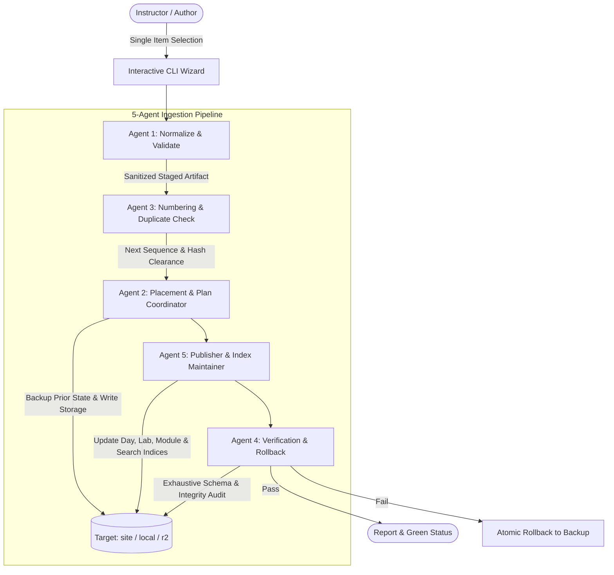

# AI-13 Course Portal — Content Ingest CLI & Multi-Agent Engine

A specialized, interactive Python CLI tool for curriculum authors and instructors to publish course materials into the portal **one item at a time** with zero credit card required.

> 📘 **Step-by-Step User Guide**: For complete everyday instructions, file preparation tips, questions generation prompt, and command reference, see [HOW_TO_USE.md](file:///d:/ai13_module/HOW_TO_USE.md).

---

## 1. Storage Targets

The Ingest tool supports three storage targets:

1. **`site` (Default, Zero-Config & Zero-Card)**:
   - Content is stored directly inside `public/content/`.
   - Served by Vite during development at `/content` and copied into `dist/content` on production builds.
   - Published via Git commit and push directly to Cloudflare Pages (`python ingest.py publish`).
   - Default target when R2 credentials are not configured.

2. **`local` (Practice Sandbox)**:
   - Content is stored in `./dev-content/` (gitignored).
   - Ideal for experimenting with content without touching the production site.

3. **`r2` (Optional Cloud Object Storage)**:
   - Uploads directly to a Cloudflare R2 bucket via S3 API.
   - For users with massive libraries (>15,000 files) who opt into Cloudflare R2.

---

## 2. Multi-Agent Engine Architecture

The Ingest tool operates via a sequential 5-agent pipeline that enforces data sanitization, optimistic concurrency, duplicate detection, and referential integrity:



### The 5 Autonomous Ingestion Agents
1. **Agent 1 (Normalize & Validate)**:
   - Validates incoming files against Cloudflare Pages limits (10MB warning, 25MB max rejection).
   - Rejects corrupt archives, password-encrypted PDFs, empty files, and legacy `.doc` files.
   - Normalizes line endings (`\r\n` $\rightarrow$ `\n`) and cleans whitespace on Markdown files.
   - Strips GPS and camera EXIF metadata from raster images, caps dimensions at 2000px, converts to optimized WebP (`q=82`), and produces a proportional 480px thumbnail.
   - Preserves binary fidelity of modern `.docx` files.
2. **Agent 2 (Placement, Metadata & Plan Coordinator)**:
   - Resolves canonical storage paths adhering to the course URL contract (`modules/<slug>/days/day-NN/...` and `modules/<slug>/labs/lab-NN/...`).
   - Parses structured Q&A Markdown files into strongly-typed question objects.
   - Backs up existing manifests into `.ingest_backups/` before any write.
3. **Agent 3 (Numbering & Duplicate Detection)**:
   - Evaluates existing days, transcripts, and board photos to suggest the next sequential number (supports non-contiguous and gap sequences).
   - Scans existing items across the module using SHA-256 content hashes to detect and warn if the same file is being uploaded twice under a different name.
4. **Agent 4 (Post-Publish Verification & Rollback)**:
   - Validates modified JSON structures against the JSON Schemas exported directly from the frontend Zod contracts (`ingest/schemas/`).
   - Checks every file reference (`FileRef`) in storage to confirm that the object exists and that its byte size matches the manifest.
   - Renders a Rich verification report. If any check fails, offers an immediate atomic rollback.
5. **Agent 5 (Publisher & Index Maintainer)**:
   - Recomputes all derived metrics (day counts, lab counts, question counts, transcript totals).
   - Aggregates whiteboard photos and architecture doodles into `/modules/<slug>/visuals.json`.
   - Maintains the root `/index.json` and updates the pre-indexed `/search-index.json`.

---

## 3. Quick Start

### Installation
```bash
pip install -r requirements.txt
```

### Initialize Storage
```bash
python ingest.py init
```

### Run Wizard
```bash
python ingest.py
```

### Check Content & Limits
```bash
python ingest.py stats
npm run check-content
```

### Publish Content
```bash
python ingest.py publish
```
Commits only `public/content/` to git with an informative commit message and pushes to Cloudflare Pages.
