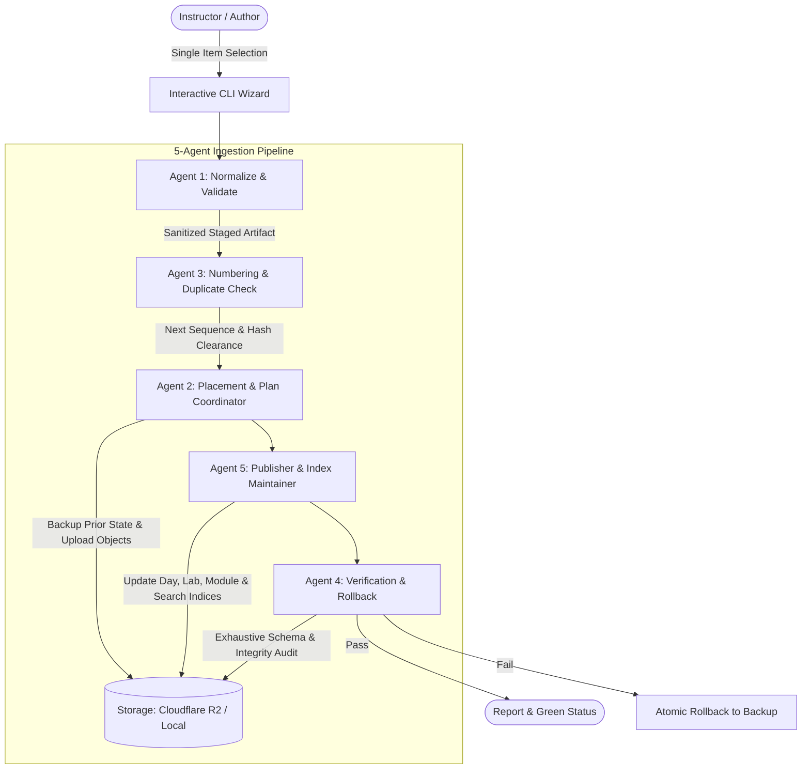

# AI-13 Course Portal — Content Ingest CLI & Multi-Agent Engine

A specialized, interactive Python CLI tool for curriculum authors and instructors to publish course materials into Cloudflare R2 (or local disk for development) **one item at a time** without requiring Git commits, code deploys, or front-end rebuilds.

> 📘 **Step-by-Step User Guide**: For complete everyday instructions, file preparation tips, questions generation prompt, and command reference, see [HOW_TO_USE.md](file:///d:/ai13_module/HOW_TO_USE.md).

---

## 1. System Architecture

The Ingest tool operates via a sequential 5-agent pipeline that enforces data sanitization, optimistic concurrency, duplicate detection, and referential integrity:



### The 5 Autonomous Ingestion Agents
1. **Agent 1 (Normalize & Validate)**:
   - Validates incoming files against strict MIME and size limits (10MB warning, 25MB max).
   - Rejects corrupt archives, password-encrypted PDFs, empty files, and legacy `.doc` files.
   - Normalizes line endings (`\r\n` $\rightarrow$ `\n`) and cleans whitespace on Markdown files.
   - Strips GPS and camera EXIF metadata from raster images, caps dimensions at 2000px, converts to optimized WebP (`q=82`), and produces a proportional 480px thumbnail.
   - Preserves binary fidelity of modern `.docx` files.
2. **Agent 2 (Placement, Metadata & Plan Coordinator)**:
   - Resolves canonical storage paths adhering to the course URL contract (`modules/<slug>/days/day-NN/...` and `modules/<slug>/labs/lab-NN/...`).
   - Parses structured Q&A Markdown files into strongly-typed question objects.
   - Backs up existing manifests into `.ingest_backups/` before any write.
3. **Agent 3 (Numbering & Duplicate Detection)**:
   - Evaluates existing days, transcripts, and board photos to suggest the next sequential number (supports non-contiguous and gap sequences).
   - Scans existing items across the module using SHA-256 content hashes to detect and warn if the same file is being uploaded twice under a different name.
4. **Agent 4 (Post-Publish Verification & Rollback)**:
   - Validates modified JSON structures against the JSON Schemas exported directly from the frontend Zod contracts (`ingest/schemas/`).
   - Checks every file reference (`FileRef`) in storage to confirm that the object exists and that its byte size matches the manifest.
   - Renders a Rich verification report. If any check fails, offers an immediate atomic rollback.
5. **Agent 5 (Publisher & Index Maintainer)**:
   - Recomputes all derived metrics (day counts, lab counts, question counts, transcript totals).
   - Aggregates whiteboard photos and architecture doodles into `/modules/<slug>/visuals.json`.
   - Maintains the root `/index.json` and updates the pre-indexed `/search-index.json`.

---

## 2. Prerequisites

- **Python 3.10+**
- **Node.js 18+** (for schema validation and frontend build)
- **Tkinter**: Built into Python on Windows and macOS. On Ubuntu/Debian Linux, install via:
  ```bash
  sudo apt-get install python3-tk
  ```

### Installation

Clone the repository and install the dependencies:
```bash
# In the repository root
pip install -r requirements.txt
pip install -r requirements-dev.txt
```

---

## 3. Storage Targets & Cloudflare R2 Setup

The ingest tool can write directly to **Cloudflare R2** (production) or **Local Disk** (offline development).

### Cloudflare R2 Production Walkthrough

#### Step 1: Create an R2 Bucket
1. Log into your [Cloudflare Dashboard](https://dash.cloudflare.com/).
2. In the left navigation, click **R2 Storage** $\rightarrow$ **Create Bucket**.
3. Name your bucket (e.g., `ai13-portal-content`).
4. Keep the location set to **Automatic** and click **Create Bucket**.

#### Step 2: Create R2 API Tokens
1. From the R2 Overview page, click **Manage R2 API Tokens** in the top right.
2. Click **Create API Token**.
3. Set Permissions to **Object Read & Write**.
4. Under "Specify bucket(s)", select your newly created bucket (`ai13-portal-content`).
5. Set TTL to "Forever" (or your preferred policy).
6. Click **Create API Token**.
7. Note down:
   - **Account ID** (found in your R2 dashboard URL or token overview)
   - **Access Key ID**
   - **Secret Access Key**

#### Step 3: Configure Bucket CORS
For the frontend site (hosted on Cloudflare Pages or custom domain) to fetch manifests and documents without CORS errors, configure the bucket CORS policy:
1. Open your bucket in Cloudflare R2 $\rightarrow$ **Settings** $\rightarrow$ **CORS Policy**.
2. Click **Add CORS Rule** and paste the following JSON:

```json
[
  {
    "AllowedOrigins": [
      "https://*.pages.dev",
      "https://your-custom-domain.com",
      "http://localhost:5173"
    ],
    "AllowedMethods": [
      "GET",
      "HEAD"
    ],
    "AllowedHeaders": [
      "*"
    ],
    "ExposeHeaders": [
      "ETag",
      "Content-Length",
      "Content-Type"
    ],
    "MaxAgeSeconds": 3600
  }
]
```

#### Step 4: Configure Environment Variables
Create a `.env` file in the project root (see `.env.example`):
```env
# Cloudflare R2 Credentials
R2_ACCOUNT_ID=your_cloudflare_account_id
R2_ACCESS_KEY_ID=your_r2_access_key_id
R2_SECRET_ACCESS_KEY=your_r2_secret_access_key
R2_BUCKET=ai13-portal-content

# Frontend Content Base URL (Cloudflare Pages Environment Variable)
VITE_CONTENT_BASE_URL=https://pub-yourbucketid.r2.dev
```

Test the connection immediately:
```bash
python ingest.py check-connection
```

---

## 4. Local Testing Without Cloudflare R2

You can test content authoring completely offline by specifying `--target local`:

```bash
# Ingest content into ./dev-content
python ingest.py --target local --root dev-content
```

To point your local Vite frontend to this directory:
1. Symlink or copy `dev-content/` into `public/dev-content/` or update `.env.development`:
   ```env
   VITE_CONTENT_BASE_URL=/mock-content
   ```
2. Verify all local content with the frontend validator:
   ```bash
   npm run check-content -- dev-content
   ```

---

## 5. Daily Instructor Workflows

The CLI enforces the **ONE-ITEM-AT-A-TIME** rule. Content is committed sequentially with clear previews and validations.

### Workflow A: Ingesting a Full Day Session (Transcripts, Photos, Summary, Q&As)

After a 4-hour class session, start the wizard:
```bash
python ingest.py
```

```
? What would you like to do?
  » Ingest Daily Course Content
    Manage Labs & Guides
    Manage Modules & Categories
    Exit
```

Follow this sequence:
1. **Create/Select Day**: Choose `Create a Course Day` $\rightarrow$ Enter Day Number, Title, and a brief class recap.
2. **Add Daily Summary**: Choose `Add Daily Summary` $\rightarrow$ Select your `.docx` or `.md` file. The tool normalizes text, strips excess whitespace, and attaches it.
3. **Add Transcripts (One by One)**:
   - Run `Add Class Transcript` $\rightarrow$ Pick `session-part1.md` $\rightarrow$ Confirm Title.
   - Run `Add Class Transcript` $\rightarrow$ Pick `session-part2.docx` $\rightarrow$ Confirm Title.
4. **Add Board Photos (One by One)**:
   - Run `Add Whiteboard / Blackboard Photo` $\rightarrow$ Pick `photo1.jpg` $\rightarrow$ Tool strips EXIF, converts to `.webp`, generates a 480px thumbnail, and registers it in `visuals.json`.
   - Repeat for `photo2.jpg`.
5. **Add Questions**:
   - Run `Add Questions & Answers` $\rightarrow$ Choose `Upload structured file (.md)`.
   - The tool parses the markdown headers and merges the questions into `day.json`.

---

## 6. Question Template Syntax

To prepare questions for bulk ingest, run:
```bash
python ingest.py questions-template
```
This generates `questions_template.md` with the standard formatting:

```markdown
## Q1: What is the primary difference between Managed Identity and Storage Access Keys?
**Answer:** Managed Identity eliminates storing secrets or rotating passwords by delegating authentication directly to Azure Active Directory.
**Explain simply:** Think of access keys like a physical house key you can accidentally drop or lose; Managed Identity is like facial recognition built directly into the front door.
**Tags:** Security, Identity, Azure

## Q2: Why configure training compute clusters to auto-scale down to zero nodes?
**Answer:** Setting minimum nodes to 0 ensures you incur zero billing charges when no training jobs are actively executing.
**Explain simply:** Like turning off the lights when leaving a room, auto-scale shuts down cloud servers the second they finish work.
**Tags:** Cost, Compute, Optimization
```

---

## 7. Maintenance, Verification & Disaster Recovery

### Check R2 Connection
```bash
python ingest.py check-connection
```

### Inspect the Content Tree
```bash
python ingest.py list
```

### Exhaustive Integrity Verification
Audits all JSON schemas, referential paths, and file sizes across storage:
```bash
python ingest.py verify
# Or verify a specific module:
python ingest.py verify --module azure-mlops-ai-300
```

### Undo Last Operation
If you uploaded the wrong document or merged incorrect questions, the prior state is automatically preserved in `.ingest_backups/`:
```bash
python ingest.py undo
```
The tool identifies the last snapshot, prompts for confirmation, restores the manifests, and recalculates all search and module indices.

### Rebuild Indices from Scratch
If files were manually moved or an index became desynchronized:
```bash
python ingest.py rebuild-index
```
Agent 5 scans all `day.json` and `lab.json` files and deterministically reconstructs `manifest.json`, `visuals.json`, `index.json`, and `search-index.json`.

---

## 8. Troubleshooting

| Issue | Cause | Solution |
| :--- | :--- | :--- |
| **Changes not visible on website** | Browser or CDN caching | Manifest files have a 60-second cache TTL. Perform a hard reload (`Ctrl+F5` or `Cmd+Shift+R`) in your browser. |
| **CORS error in browser console** | Missing R2 CORS policy | Review Section 3 (Step 3) and ensure `GET` and `HEAD` methods with `AllowedOrigins: ["*"]` are configured. |
| **Concurrency Conflict (`ConcurrencyError` / `412`)** | Multiple authors updating simultaneously | The storage engine uses optimistic concurrency (`If-Match` ETag headers). Run `python ingest.py verify` to check the current state, then re-attempt your operation. |
| **`Legacy Word .doc format is not supported`** | File in binary `.doc` format | Modern web applications require standard `.docx` (Office Open XML). Open the file in Word or LibreOffice and click **Save As $\rightarrow$ .docx**. |
| **`Schema error at ...`** | Malformed manual edits | Run `python ingest.py rebuild-index` or revert using `python ingest.py undo`. |

